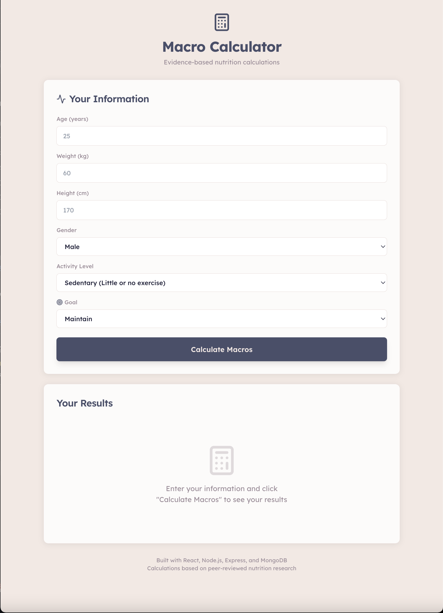
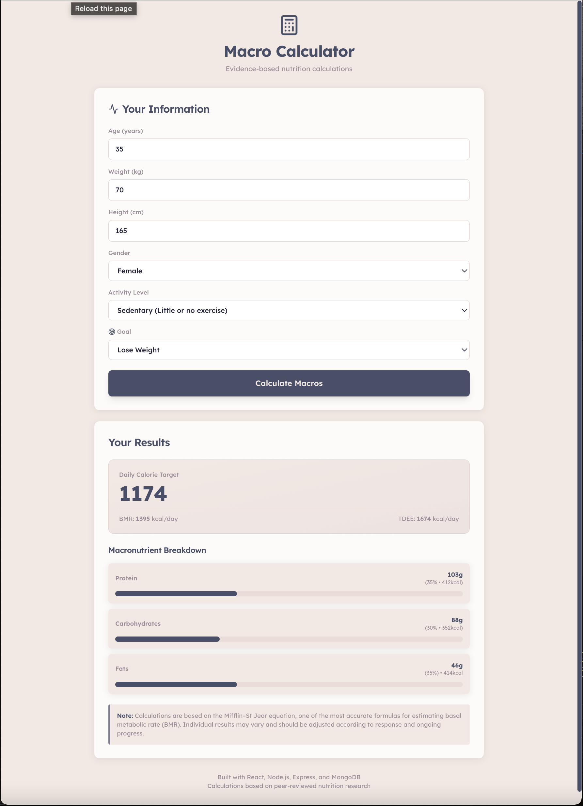

# 💪 Macro Calculator Pro

## 🌐 Live Demo

**[View Live Demo](https://macro-calculator-pi.vercel.app/)**

A React web app that calculates personalized daily calorie targets and a macronutrient breakdown based on your information and fitness goal. All calculations run in the browser, so results appear instantly and nothing you enter is stored.




## 🌟 Features

- **Accurate BMR Calculation** - Uses the Mifflin-St Jeor equation
- **Activity-Based TDEE** - Adjusts for 5 different activity levels
- **Goal-Oriented Plans** - Tailored macros for weight loss, maintenance, or muscle gain
- **US or Metric Units** - Enter lb and ft/in, or kg and cm
- **Safe Minimum** - Calorie targets never go below 1,200 kcal/day, with a clear warning when the formula suggests less
- **Muscle Gain Guidance** - A short tip on strength training and protein timing for the gain goal
- **Visual Breakdown** - Progress bars showing macro distribution
- **Private by Design** - Runs entirely in the browser; no personal data is sent or saved
- **Form Validation** - A friendly toast message if a field is left empty
- **Responsive Design** - Works on desktop, tablet, and mobile

## 🛠️ Tech Stack

- React.js
- CSS3 with custom animations
- Tailwind CSS
- Lucide React (icons)
- React Hot Toast (notifications)
- Deployed on Vercel

**Development Tools:** npm, Git & GitHub, VS Code

## 📦 Installation

### Prerequisites
- Node.js (v14 or higher)
- npm

### Clone and run
```bash
git clone https://github.com/nikki-builds/Macro-Calculator.git
cd Macro-Calculator
npm install
npm start
```

The app will open at `http://localhost:3000`. No environment variables or database are needed.

## 🎯 How It Works

1. **Enter Your Information**
   - Age, weight (lb or kg), height (ft/in or cm), gender
   - Activity level (sedentary to very active)
   - Goal (lose weight, maintain, or gain muscle)

2. **Calculate**
   - Calculates BMR using the Mifflin-St Jeor equation
   - Determines TDEE based on activity level
   - Adjusts calories for your goal (+/- 500 kcal), with a 1,200 kcal minimum

3. **View Results**
   - Daily calorie target, with BMR and TDEE explained
   - Protein, carbs, and fats in grams, percentages, and calories

## 📊 Calculation Methods

### Units
The formulas use kilograms and centimeters. US inputs are converted first:
- 1 lb = 0.4536 kg
- 1 in = 2.54 cm (height in ft/in is converted to total inches first)

### BMR (Basal Metabolic Rate)
Energy your body uses at rest, using the Mifflin-St Jeor equation:

**Men:** BMR = 10 × weight(kg) + 6.25 × height(cm) - 5 × age(years) + 5  
**Women:** BMR = 10 × weight(kg) + 6.25 × height(cm) - 5 × age(years) - 161

### TDEE (Total Daily Energy Expenditure)
TDEE = BMR × Activity Multiplier
- Sedentary: 1.2
- Light: 1.375
- Moderate: 1.55
- Active: 1.725
- Very Active: 1.9

### Daily Calorie Target
- **Lose Weight:** TDEE - 500 kcal
- **Maintain:** TDEE
- **Gain Muscle:** TDEE + 500 kcal

The target never goes below **1,200 kcal/day**. If the formula suggests less, the app uses 1,200 and shows a warning, since eating below that level isn't recommended for adults without medical supervision.

### Macronutrients
Protein is based on body weight, not on a share of calories, so it doesn't grow just because calories are high.

| Goal | Protein | Fat | Carbohydrates |
|---|---|---|---|
| Lose Weight | 1.8 g per kg of body weight | 30% of calories | Remaining calories |
| Maintain | 1.4 g per kg of body weight | 30% of calories | Remaining calories |
| Gain Muscle | 1.8 g per kg of body weight | 25% of calories | Remaining calories |

Grams are converted using 4 kcal/g for protein and carbohydrates and 9 kcal/g for fat. Percentages shown in the app are each macro's calories divided by the daily target.

## 🧪 About the `server` Folder

This repo also contains a Node.js + Express + MongoDB backend (`server/`) that I built to practice connecting a frontend to an API and a database. The first live version saved every calculation to MongoDB.

I later removed that from the live app. A calculator doesn't need to remember anything (the same inputs always give the same result), users had no way to view saved results, and storing people's age, weight, and height without a clear purpose isn't a good practice for a health app. Removing it also made the app faster, since it no longer waits for a server.

The backend code is kept for reference. Its endpoints:
- `POST /api/calculations` - Save a calculation
- `GET /api/calculations` - Get all calculations
- `GET /api/calculations/:id` - Get a single calculation
- `DELETE /api/calculations/:id` - Delete a calculation

## 🚀 Future Enhancements

- [ ] Meal planning suggestions
- [ ] Export results as PDF
- [ ] Optional saved history (stored on your device)

## 🤝 Contributing

Contributions are welcome! Please feel free to submit a Pull Request.

## 📝 License

MIT License.

## 👤 Author

**Na Yeon (Nikki) Kim**
- Transitioning from nutrition background to tech
- Combining nutrition expertise with web development

## 🙏 Acknowledgments

- Mifflin-St Jeor equation for BMR calculation
- Nutrition research for macro distribution guidelines
- React community
